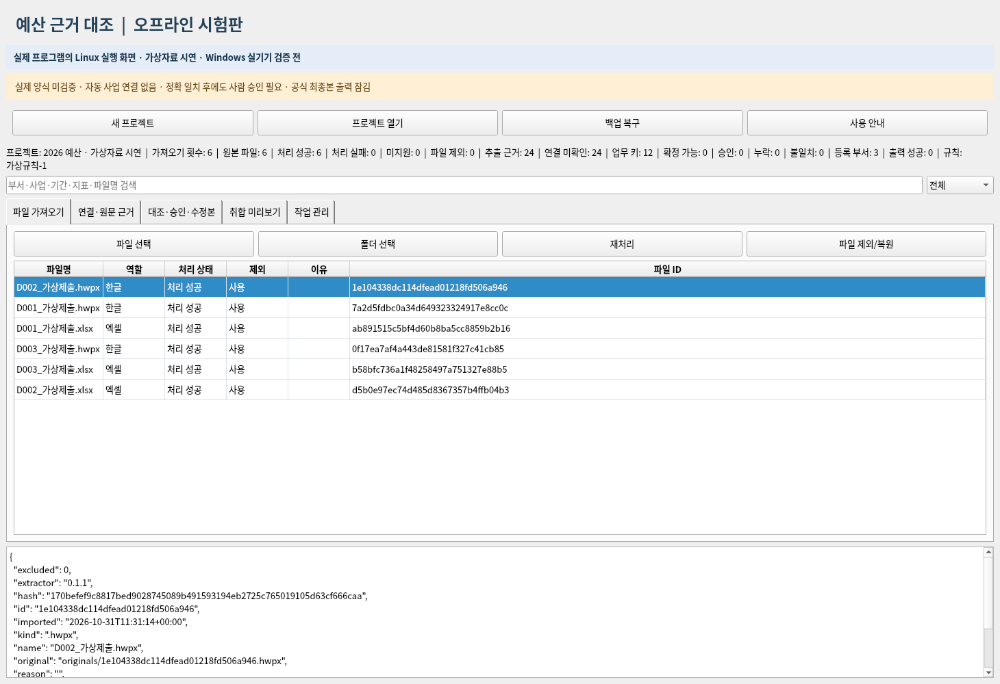
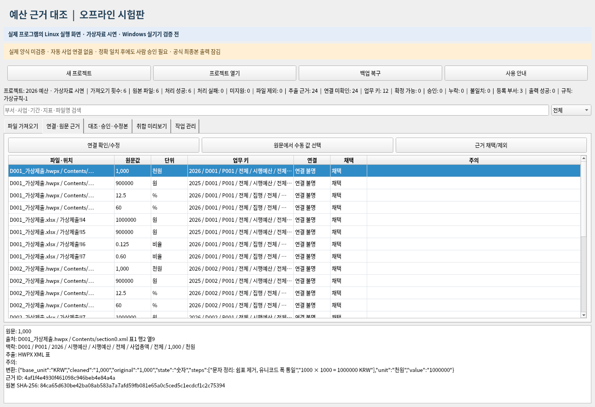
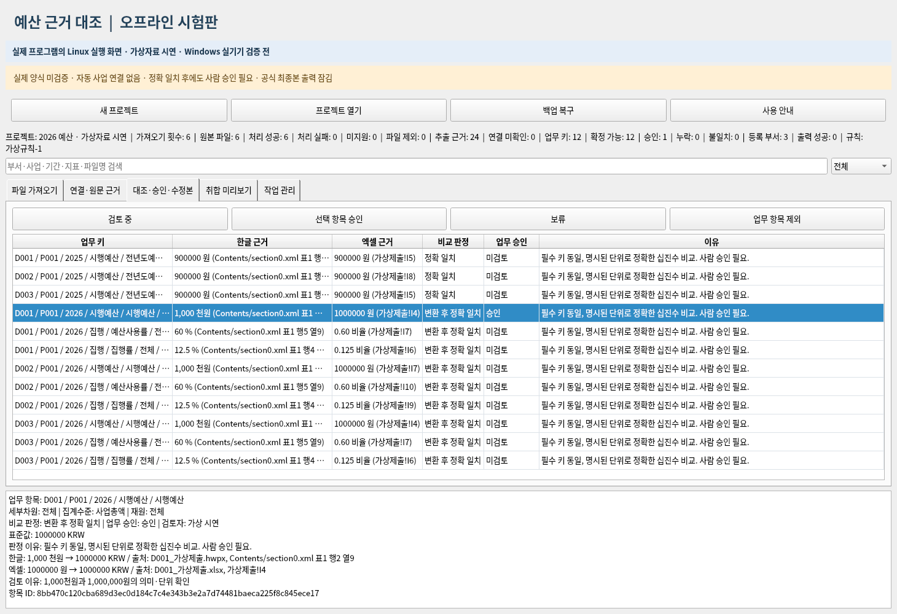
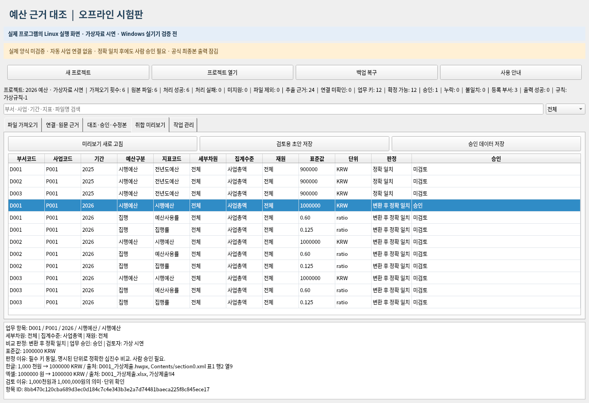
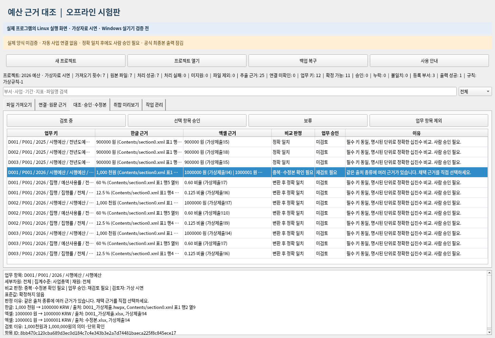

# 실제 화면으로 따라 하기 — 0.1.1

다음 화면은 실제 프로그램에 가상자료를 넣어 Linux에서 실행·캡처한 것입니다. 디자인 시안이나 Windows 실행 결과가 아닙니다. Windows 11에서의 실행·권한 차단·방화벽 동작은 업무 PC에서 따로 확인해야 합니다.

## 처음 실행

1. 0.1.1 Windows ZIP을 기관 승인 경로로 받아 **모두 압축 풀기**합니다. 예전 0.1.0을 사용하지 않습니다.
2. 기관 담당자가 PC의 망분리·방화벽을 확인합니다. 필요할 때 담당자만 `방화벽설정_기관관리자전용.cmd`를 실행하고 그 창을 닫습니다. 이 관리 도구는 예산 프로그램을 실행하지 않습니다.
3. 일반 사용자 바탕화면에서 **실행.cmd를 그냥 더블클릭**합니다. 권한을 높여 실행하면 프로그램이 중단합니다. 권한 상승 승인창을 요청하는 기능도 없습니다.
4. **새 프로젝트**를 누르고 쓰기 가능한 승인된 로컬 폴더와 새 프로젝트 이름을 정합니다. 기관이 지정한 작업 폴더를 사용하고, 프로그램 설치 폴더와 분리합니다.

## 1. 가상 파일 가져오기

**파일 가져오기 → 폴더 선택 → samples/정상자료**를 선택합니다. 3개 부서의 한글·엑셀 6개를 읽습니다. 이 단계에서는 읽기만 끝났고 업무 연결·승인은 아직 하지 않았습니다.

**작업 관리 → 부서·필수 항목 JSON 등록**에서 `samples/필수항목.json`을 등록합니다. 그래야 필요한 부서·지표가 빠졌는지 확인할 기준이 생깁니다.

## 2. 원문을 보고 연결 확인

**연결·원문 근거**에서 `D001`의 시행예산 근거를 선택합니다. 아래에 `1,000`, `천원`, 파일명과 표 위치가 표시됩니다. **연결 확인/수정**에서 부서·사업·기간·예산구분·지표·세부차원·집계수준·재원과 단위를 확인하고 검토자·이유를 씁니다. 엑셀 쪽 근거도 각각 확인합니다.

시연 도구는 명시된 가상 정답에 따라 확인 동작을 실행했습니다. 프로그램이 실제 자료를 자동 연결·일괄 승인한다는 의미는 아닙니다.

## 3. 대조 후 한 항목 승인

**대조·승인·수정본**에서 한글 `1,000 천원`과 엑셀 `1000000 원`의 비교 결과를 확인합니다. 두 값은 같은 키일 때 표준값 `1000000 KRW`로 비교되며 `변환 후 정확 일치`입니다. `KRW`는 원화 표시입니다.

확인한 한 행을 선택하고 **선택 항목 승인**을 누릅니다. 아래 화면은 이 가상 항목 하나만 승인한 상태입니다. 다른 지표들은 `미검토`로 남아 있습니다.

## 4. 미리보기와 출력

**취합 미리보기**는 지표를 한 행씩 쌓은 long 표입니다. **검토용 초안 저장**은 미해결 내용을 포함하고, **승인 데이터 저장**은 현재 검증과 승인을 통과한 값만 담습니다. wide 표와 근거·이력은 출력 XLSX의 별도 시트에서 봅니다.

파일은 프로젝트의 `exports` 폴더에 새 이름으로 저장됩니다. 이 출력은 시험용이며 실제 기관의 최종 제출 양식은 잠겨 있습니다.

## 5. 수정본이 오면 재검토

시연에서는 승인 후 같은 키의 엑셀 수정본 `1000001 원`을 추가했습니다. 기존 `1000000 원`을 덮어쓰지 않았고 `중복·수정본 확인 필요`, `재검토 필요`로 바뀌었습니다.

담당자가 근거를 확인해 채택하지 않을 버전을 제외하고 이유를 남겨야 합니다. 불일치가 남아 있으면 승인할 수 없습니다. 끝나면 **작업 관리 → 프로젝트 백업**으로 백업하고 **백업 복구**로 새 폴더 복구를 시험합니다.

## 자동 가상시험만 빠르게 실행

`가상시험.cmd`를 일반 더블클릭합니다. 관리자 권한이면 시작하지 않습니다. 끝나면 `%LOCALAPPDATA%\BudgetOffline\selftest-results` 아래 생성한 결과 경로와 PASS/FAILED를 표시합니다. 이 동작은 처음부터 만든 가상자료만 쓰며 실제 업무 프로젝트를 자동 승인하지 않습니다.

캡처 재현 명령(개발자용): `QT_QPA_PLATFORM=offscreen .venv/bin/python tools/demo_screens.py 새시연폴더 docs/demo`. 클릭 결과와 같은 실제 처리 함수를 사용한 시연이며, 승인·출력·수정본 무효화를 검증한 뒤 화면을 저장합니다.
