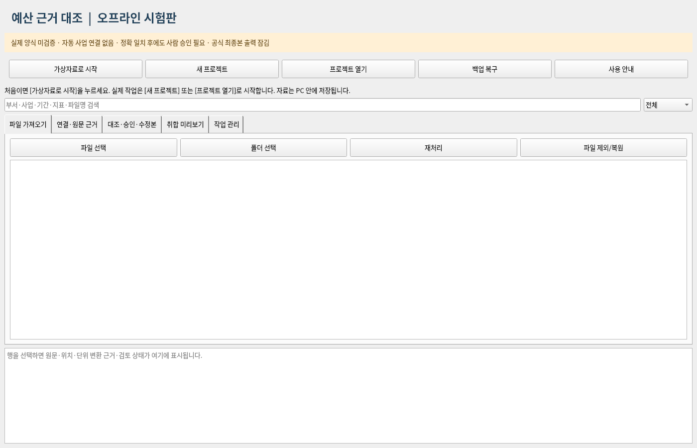

# Python 없이 바로 시작하기 — 0.1.2

받을 파일은 **BudgetOffline-0.1.2-Windows-x64.exe**입니다. Python, 개발 도구, 명령 프롬프트를 별도로 준비하지 않습니다. Windows 11 64비트용입니다. Windows 실기기 실행은 개발 환경에서 시험하지 못했으므로 기관 시험 PC에서 가상자료부터 확인하세요.

1. 기관에서 승인한 반입 절차로 EXE를 로컬 폴더에 저장합니다. 보안 담당자가 출처·기준 SHA-256·실행 허가를 확인합니다. 업무 PC가 망분리되어 있다면 그 PC로 인터넷에 접속하지 않습니다.
2. EXE를 **그냥 더블클릭**합니다. “관리자 권한으로 실행”을 선택하지 않습니다. 이 프로그램은 높아진 관리자 권한이면 중단합니다.
3. **오프라인 예산 시험판 — 실행 준비** 창에서 파일 준비·확인을 기다립니다. 인터넷에서 받는 과정이 아닙니다. EXE 안의 Python과 화면 라이브러리를 사용자 로컬 폴더에 꺼냅니다. 이 창을 닫으면 준비를 취소합니다.
4. **예산 근거 대조** 화면이 열리면 맨 위 **가상자료로 시작**을 누릅니다.
5. 기관이 허용한 작업 폴더를 고르고 새 이름 `2026_가상시험`을 입력합니다. 프로그램 폴더와 작업 폴더는 따로 사용합니다.
6. 3개 부서의 파일 6개, 원문 근거 24개, 업무 항목 12개를 읽습니다. 필요한 부서·지표 목록도 함께 등록합니다. 읽기를 마쳐도 자동 연결 확인·승인은 하지 않습니다.
7. **연결·원문 근거**에서 한글과 엑셀의 같은 항목을 각각 선택합니다. 원문·키·단위를 확인하고 **연결 확인/수정**에 검토자와 이유를 적습니다.
8. **대조·승인·수정본**에서 결과를 확인한 뒤 한 행씩 **선택 항목 승인**을 누릅니다. **취합 미리보기 → 승인 데이터 저장**을 누르면 작업 폴더의 `exports`에 엑셀이 생깁니다.
9. **작업 관리 → 프로젝트 백업**으로 백업하고 프로그램을 닫습니다. 다음에는 같은 EXE를 실행하고 **프로젝트 열기**로 작업을 이어갑니다.

예: D001의 시행예산에서 한글 `1,000 천원`과 엑셀 `1000000 원`은 같은 업무 키를 확인한 뒤 `변환 후 정확 일치`로 표시됩니다. 이 판정도 사용자 승인 전에는 승인 데이터에 들어가지 않습니다. 실제 제출 양식 출력은 아직 잠겨 있습니다.

이 화면은 실제 앱의 Linux 실행 캡처입니다. Windows EXE를 실행한 화면이라고 주장하지 않습니다. 이어지는 근거·승인·수정본 화면은 [DEMO.md](DEMO.md)에서 볼 수 있습니다.

## 보고한 오류의 뜻

`runtime\python.exe is not recognized`는 예전 실행 스크립트가 **묶음 안의 Python 파일을 찾거나 실행하지 못했다**는 뜻입니다. PC에 Python을 별도로 설치하지 않아서 생긴 문제라고 단정할 수 없습니다. ZIP 안에서 실행했거나 일부만 풀었거나 보안 제품이 파일을 격리했을 수 있지만 사용자 PC의 정확한 원인은 아직 확인하지 못했습니다.

이어서 나온 “Administrator execution is prohibited”는 이전 스크립트가 모든 시작 실패에 붙인 부정확한 안내였습니다. 0.1.2는 원인을 나누어 알리고, 단일 EXE는 직접 압축 풀기·폴더 배치 없이 실행 환경을 준비합니다. 실제 관리자 권한 실행 차단은 유지합니다.

## 실행이 차단되면

- SmartScreen·기관 보안제품이 막으면 끄거나 우회하지 말고 담당자에게 허용·서명 절차를 확인받습니다. 배포 EXE는 코드 서명 전 시험판입니다.
- “기존 실행 파일이 없거나 바뀌었습니다”라면 자동 재생성하지 않습니다. 격리·변조 원인을 기관 담당자가 확인해야 합니다. 무조건 삭제하고 다시 실행해 보안 차단을 우회하지 않습니다.
- 화면 시작에 실패하면 안내창에 로컬 시작 기록 경로가 나옵니다. 실제 자료·전체 로그를 외부로 보내지 않습니다.
- 예전 ZIP의 프로젝트는 지우지 마세요. 프로그램을 닫고 프로젝트 전체를 백업한 뒤 새 EXE에서 **프로젝트 열기**로 엽니다.

준비한 프로그램은 `%LOCALAPPDATA%\BudgetOffline\app\0.1.2-묶음지문`에, 시작 기록은 `%LOCALAPPDATA%\BudgetOffline\logs`에 있습니다. `묶음지문`은 배포 파일에 따라 달라지는 문자열입니다. 로컬 프로그램 준비에는 여유 공간 1GB 이상을 권장하며 작업·백업 공간은 별도로 필요합니다. 재실행 때도 포함 파일의 해시를 확인하므로 준비 시간이 걸릴 수 있습니다. 업무 작업은 사용자가 고른 별도 폴더에 저장합니다.
